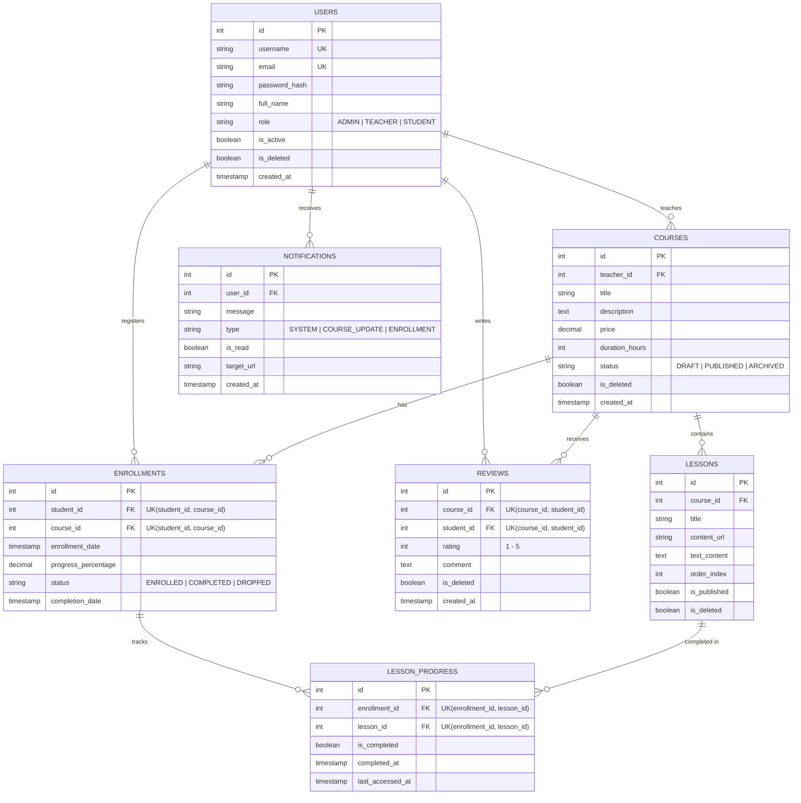

# Course Management System - RESTful API Backend

A robust, enterprise-grade RESTful Course Management System backend built with **Java 21**, **Spring Boot 4.1**, **Spring Security 6**, and **PostgreSQL**. Engineered with clean architecture principles, strict Role-Based Access Control (RBAC), stateless JWT authentication, automated integration testing, and interactive OpenAPI/Swagger documentation.

---

## Table of Contents
- [Overview](#overview)
- [Key Features](#key-features)
- [Tech Stack](#tech-stack)
- [System Architecture](#system-architecture)
- [Security Flow & RBAC](#security-flow--rbac)
- [Roles & Permissions](#roles--permissions)
- [Database Schema](#database-schema)
- [API Modules & Endpoints Summary](#api-modules--endpoints-summary)
- [Getting Started & Local Setup](#getting-started--local-setup)
- [API Documentation (Swagger UI)](#api-documentation-swagger-ui)
- [Testing](#testing)
- [Project Structure](#project-structure)
- [Author & Contact](#author--contact)

---

## Overview

The **Course Management System Backend** provides a complete end-to-end learning platform solution. It manages the entire lifecycle of educational content: user authentication with email OTP verification, course publishing workflows, multimedia lesson delivery with Cloudinary integration, enrollment tracking, dynamic progress calculation, student reviews, and administrative reporting.

Designed as a modern enterprise portfolio project demonstrating best practices in Spring Boot, transactional data consistency, defensive programming, and secure API design.

---

## Key Features

- **Authentication & Authorization:**
  - Stateless JWT (JSON Web Tokens) with separate Access and Refresh token lifecycle.
  - User registration with email activation (6-digit OTP via Spring Mail SMTP).
  - Secure password hashing using BCrypt.
  - Password recovery flow with OTP verification.
  - Role-Based Access Control (RBAC) across three distinct user roles (`ADMIN`, `TEACHER`, `STUDENT`).
  - Resource ownership enforcement (Teachers only manage their assigned courses; Students only manage their own enrollments/reviews).

- **Course & Lesson Management:**
  - Course status state transitions (`DRAFT` &rarr; `PUBLISHED` &rarr; `ARCHIVED`).
  - Comprehensive course catalog with dynamic search, teacher filtering, and pagination via Spring Data Specifications.
  - Sequential lesson ordering (`orderIndex`) with uniqueness validation within courses.
  - Multimedia lesson content support (video/document uploads to Cloudinary or rich text content).
  - Public preview support for selected lesson materials.

- **Enrollment & Learning Progress Tracking:**
  - Enrollment validation (only published courses can be enrolled; duplicate enrollment prevention).
  - Dynamic completion rate calculation: `progressPercentage = (completedPublishedLessons / totalPublishedLessons) * 100`.
  - Zero-division safety checks for newly created courses.
  - Automatic enrollment status transition to `COMPLETED` when all published lessons are completed.

- **Reviews & Ratings:**
  - Course ratings (1–5 stars) with mandatory text feedback.
  - Business rules: Only enrolled students who completed &gt; 0% of the course can review.
  - Single review constraint per student per course (subsequent modifications require the Update API).
  - Ownership protection: Students can edit their own reviews; Admins can moderate/delete any review.

- **Notifications & Administrative Reports:**
  - In-app notification dispatch and read-state management.
  - Administrative analytical reports: Top popular courses by enrollment, individual student progress tracking, and teacher course overview metrics powered by optimized JPA aggregation queries.

- **Robust Engineering Standards:**
  - Standardized JSON response envelope (`ApiResponse<T>`) for consistent frontend consumption.
  - Centralized Global Exception Handling with `@RestControllerAdvice`.
  - Input validation using Jakarta Bean Validation (`@Valid`, `@NotNull`, `@NotBlank`, `@Min`, `@Max`).
  - Environment-based configuration management (`.env.example`) to prevent secret exposure.

---

## Tech Stack

| Category | Technology |
|---|---|
| **Language** | Java 21 (LTS) |
| **Framework** | Spring Boot 4.1.0 |
| **Security** | Spring Security 6, JJWT (io.jsonwebtoken 0.11.2) |
| **Data Access** | Spring Data JPA, Hibernate, PostgreSQL Driver |
| **Database** | PostgreSQL 16+ (Production/Dev), H2 Database (In-Memory for Automated Tests) |
| **Validation** | Jakarta Bean Validation (Hibernate Validator) |
| **Object Mapping** | MapStruct 1.5.5.Final, Lombok |
| **Third-Party Services** | Cloudinary Java SDK (Cloud Storage), JavaMailSender (Email OTP) |
| **Documentation** | Springdoc OpenAPI 2.8.5 (Swagger UI 3.0) |
| **Build & Test** | Gradle 8.x/9.x, JUnit 5, Spring Boot Test, MockMvc, AssertJ |

---

## System Architecture

The application strictly follows the classic **Layered N-Tier Architecture** ensuring clean separation of concerns and maintainability:

```text
  [ Client (Web / Mobile / Swagger UI / Bruno) ]
                        │
                        ▼ (HTTP Request with JWT Bearer Token)
  [ Security Layer: JwtAuthenticationFilter & SecurityFilterChain ]
                        │
                        ▼ (Authenticated SecurityContext)
  [ Controller Layer (@RestController) ]
    - Request validation (@Valid DTOs)
    - Response serialization (ApiResponse<T>)
                        │
                        ▼
  [ Service Layer (@Service & @Transactional) ]
    - Core business logic execution
    - Access control & Resource ownership checks
    - Entity mapping via MapStruct
                        │
                        ▼
  [ Repository Layer (Spring Data JPA) ]
    - JpaRepository & JpaSpecificationExecutor
    - Native / JPQL Aggregation queries
                        │
                        ▼
  [ Database (PostgreSQL / In-Memory H2) ]
```

---

## Security Flow & RBAC

```text
 1. POST /api/auth/login (username, password)
    └──> AuthenticationManager ──> CustomUserDetailsService ──> BCryptPasswordEncoder
         └──> Generates JWT Access Token (short-lived) & Refresh Token (long-lived)

 2. Client sends Request: Authorization: Bearer <AccessToken>
    └──> JwtAuthenticationFilter parses Bearer token
         └──> Validates token signature, expiration, and ensures token type is ACCESS
         └──> Loads CustomUserDetails
         └──> Builds UsernamePasswordAuthenticationToken -> sets in SecurityContextHolder

 3. Method Security / Route Authorization:
    ├── Unauthorized (Missing / Expired Token) ──> 401 UNAUTHORIZED (CustomAuthenticationEntryPoint)
    ├── Forbidden (Insufficient Role / Access) ──> 403 ACCESS_DENIED (CustomAccessDeniedHandler)
    └── Authorized ────────────────────────────> Service Layer Ownership Check ──> Controller
```

---

## Roles & Permissions

| Feature / Resource | Public | STUDENT | TEACHER | ADMIN |
|---|:---:|:---:|:---:|:---:|
| User Registration & OTP Activation | :white_check_mark: | - | - | - |
| Login / Refresh Token / Forgot Password | :white_check_mark: | :white_check_mark: | :white_check_mark: | :white_check_mark: |
| View Profile / Update Self Profile | - | :white_check_mark: | :white_check_mark: | :white_check_mark: |
| User Management (CRUD, Lock, Role Update) | - | - | - | :white_check_mark: |
| Browse Published Courses & Lessons | :white_check_mark: | :white_check_mark: | :white_check_mark: | :white_check_mark: |
| Create / Edit / Delete Courses | - | - | - | :white_check_mark: |
| Create / Edit / Delete Lessons | - | - | :white_check_mark: *(Own courses only)* | :white_check_mark: |
| Course Enrollment & Progress Update | - | :white_check_mark: | - | - |
| Submit / Edit Course Review | - | :white_check_mark: *(Enrolled & started)* | - | - |
| Delete Review | - | :white_check_mark: *(Own review)* | - | :white_check_mark: *(Moderation)* |
| Notifications (Read / Delete) | - | :white_check_mark: *(Own)* | :white_check_mark: *(Own)* | :white_check_mark: *(All)* |
| Analytics & Reports | - | - | - | :white_check_mark: |

> **Special Business Rule:** Administrators are strictly prohibited from modifying the role of another Administrator (`AccessDeniedException` 403).

---

## Database Schema

The relational schema is composed of 7 core entities with strict referential integrity and unique constraints:



---

## API Modules & Endpoints Summary

The original backend exposes 45 REST API endpoints. This Week 2 learning copy adds one Course PATCH route, for **46 endpoints** across 8 functional modules:

| Module | Base Path | Total Endpoints | GET | POST | PUT | PATCH | DELETE |
|---|---|:---:|:---:|:---:|:---:|:---:|:---:|
| **Authentication** | `/api/auth` | **9** | 1 | 8 | 0 | 0 | 0 |
| **Users Management** | `/api/users` | **8** | 2 | 1 | 4 | 0 | 1 |
| **Courses Management** | `/api/courses` | **7** | 2 | 1 | 2 | 1 | 1 |
| **Lessons Management** | `/api/lessons` & `/api/courses/{id}/lessons` | **7** | 3 | 1 | 2 | 0 | 1 |
| **Enrollments & Progress** | `/api/enrollments` | **4** | 2 | 1 | 1 | 0 | 0 |
| **Notifications** | `/api/notifications` | **4** | 1 | 1 | 1 | 0 | 1 |
| **Reviews & Ratings** | `/api/reviews` & `/api/courses/{id}/reviews` | **4** | 1 | 1 | 1 | 0 | 1 |
| **Reports & Analytics** | `/api/reports` | **3** | 3 | 0 | 0 | 0 | 0 |
| **TOTAL** | | **46** | **15** | **14** | **11** | **1** | **5** |

*(Week 2 addition: `PATCH /api/courses/{course_id}`. The original ZIP did not contain this route; this educational copy adds it. The existing PUT mapping still ignores null DTO fields, so its behavior can be partial-update-like.)*

---

## Quick Start with Docker

You can run both the Spring Boot application and PostgreSQL database with a single command using Docker Compose:

### 1. Configure Environment
```bash
# Windows PowerShell
Copy-Item .env.example .env

# Linux / macOS
cp .env.example .env
```
> **Note:** Fill in a valid Base64-encoded 256-bit `JWT_SECRET` in `.env` (e.g., generated with `openssl rand -base64 32`). Mail and Cloudinary keys are optional for local evaluation.

### 2. Build and Launch Containers
```bash
docker compose up --build -d
```
- `postgres`: PostgreSQL 16 on port `5432` with automated healthcheck via `pg_isready`.
- `app`: Spring Boot application on port `8080`, launches automatically after PostgreSQL is healthy.

### 3. Verify & Access Swagger UI
- **Swagger UI:** [http://localhost:8080/swagger-ui/index.html](http://localhost:8080/swagger-ui/index.html)
- **OpenAPI Spec:** [http://localhost:8080/v3/api-docs](http://localhost:8080/v3/api-docs)

### 4. Stop Containers
```bash
docker compose down
```
*(Omitting `-v` preserves the `course_management_postgres_data` volume).*

### 5. Recommended Local Development Setup (PostgreSQL via Docker + Spring Boot Natively)
To quickly run without waiting for Docker to package the full app image:
1. Start only PostgreSQL via Docker Compose:
   ```bash
   docker compose up -d postgres
   ```
2. Launch Spring Boot natively on host:
   ```bash
   # Windows
   .\gradlew.bat bootRun

   # Linux / macOS
   ./gradlew bootRun
   ```
   Or execute the pre-built jar:
   ```bash
   java -jar build/libs/CourseManagement_FinalProjectModule03-0.0.1-SNAPSHOT.jar
   ```

---

## Getting Started & Local Setup (Without Docker)

### Prerequisites
- **Java Development Kit (JDK):** Version 21 or higher installed (`java -version`).
- **PostgreSQL Database:** Version 15 or higher running locally.
- **Gradle:** Wrapper included (`gradlew` / `gradlew.bat`).

### Step 1: Clone Repository
```bash
git clone https://github.com/your-username/course-management-system.git
cd course-management-system
```

### Step 2: Configure Environment Variables
Copy `.env.example` to create your environment variables:
```bash
# Windows PowerShell
Copy-Item .env.example .env
```

Edit your environment variables or provide them via system properties:
```env
DB_URL=jdbc:postgresql://localhost:5432/final_project_03
DB_USERNAME=postgres
DB_PASSWORD=your_secure_password
JWT_SECRET=replace_with_your_base64_encoded_256bit_secret
CLOUDINARY_CLOUD_NAME=your_cloud_name
CLOUDINARY_API_KEY=your_api_key
CLOUDINARY_API_SECRET=your_api_secret
MAIL_USERNAME=your_email@gmail.com
MAIL_PASSWORD=your_gmail_app_password
```

### Step 3: Run the Application
```bash
# Windows
.\gradlew.bat bootRun

# Linux / macOS
./gradlew bootRun
```

The application will start on `http://localhost:8080`.

### Default Seed Accounts (For Quick Evaluation)
Upon first startup, `DataInitializer` pre-seeds test accounts:
| Role | Username | Password | Notes |
|---|---|---|---|
| **ADMIN** | `admin` | `123456` | Master admin account |
| **ADMIN** | `admin_2` | `123456` | Secondary admin (used to verify role-lock rule) |
| **TEACHER** | `teacher_active` | `123456` | Active instructor with assigned courses |
| **TEACHER** | `teacher_banned` | `123456` | Deactivated instructor account (`isActive=false`) |
| **STUDENT** | `student_pro` | `123456` | Student with completed course & review |
| **STUDENT** | `student_lazy` | `123456` | Student with 0% progress enrollment |
| **STUDENT** | `student_new` | `123456` | Fresh student account with no enrollments |

---

## Week 2 Learning Notes

This folder is a cleaned copy of the Course Management source project shared for the Week 2 exercises. It intentionally omits local `.env`, local IDE settings, Git history, generated build files, and logs. Use `.env.example` as a local starting point and do not commit generated `.env` or Bruno `Local.yml` files.

The original project had no Course PATCH route. This Week 2 copy adds `PATCH /api/courses/{course_id}` and a test that rejects an update body containing no editable fields. The route reuses `CourseUpdateRequest` and the existing service. The existing MapStruct mapper ignores null values, which means current PUT behavior can also act like a partial update; that contract is called out in the Week 2 notes.

The full Bruno OpenCollection is under `bruno/`. The `Week 2 - Course CRUD` folder in that collection is the recommended short demonstration for GET, pagination, POST, GET-by-ID, PUT, PATCH, validation errors, not-found errors, and DELETE.

---

## API Documentation (Swagger UI)

Interactive OpenAPI v3 documentation is configured and accessible directly in your browser:

- **Swagger UI URL:** [http://localhost:8080/swagger-ui/index.html](http://localhost:8080/swagger-ui/index.html)
- **OpenAPI JSON Docs:** [http://localhost:8080/v3/api-docs](http://localhost:8080/v3/api-docs)

### How to Authorize on Swagger:
1. Call `POST /api/auth/login` with `admin` / `123456`.
2. Copy the `accessToken` from the response.
3. Click the green **Authorize** button at the top right of the Swagger UI.
4. Enter the token in the format: `Bearer <your_token>` (or just the token string).
5. All protected endpoints can now be executed directly from Swagger UI!

---

## Testing

The project includes an automated integration test suite written with **JUnit 5**, **Spring Boot Test**, and **MockMvc**, backed by an **H2 in-memory database in PostgreSQL compatibility mode** (no external PostgreSQL server required to run tests).

### Run Test Suite
```bash
# Windows
.\gradlew.bat test

# Linux / macOS
./gradlew test
```

### API testing with Bruno
The `bruno/` directory contains the OpenCollection YAML requests sourced from the project archive, plus a **Week 2 - Course CRUD** folder for the ordered CRUD, pagination, validation-error, and not-found demonstration. Open the `bruno/` directory in Bruno. Copy `bruno/environments/Local.example.yml` to `bruno/environments/Local.yml` and change the first line to `name: Local`; then run `auth/Login(1)`, and copy `data.accessToken` into `adminToken`. Do not commit local environment files or live tokens.

### Automated Test Coverage Highlights:
- **`AuthControllerTest`:**
  - Login success & token generation.
  - Login failure on invalid credentials (401 `BAD_CREDENTIALS`).
  - Login rejection for deactivated accounts (`isActive=false`).
  - Unauthorized access without Bearer token (401 `UNAUTHORIZED`).
  - Access to current user profile `/api/auth/me`.
- **`SecurityAndRbacTest`:**
  - Admin access verification on administrative endpoints (200 `OK`).
  - Student RBAC rejection on admin endpoints (403 `ACCESS_DENIED`).
  - Strict rule enforcement: Admin cannot change the role of another Admin (403 `ACCESS_DENIED`).
  - Teacher course ownership enforcement: Instructors cannot manage lessons of courses they do not own (403 `ACCESS_DENIED`).
- **`EnrollmentAndProgressTest`:**
  - Student course enrollment creation (201 `CREATED`).
  - Duplicate enrollment prevention (409 `DUPLICATE_RESOURCE`).
  - Step-by-step lesson completion & dynamic progress recalculation (50% &rarr; 100%).
  - Automatic status transition to `COMPLETED` upon full curriculum completion.
- **`CoursePatchValidationTest`:** rejects a PATCH/PUT update request that contains no editable fields.
- **`ReviewAndExceptionHandlingTest`:**
  - Request validation (@Min 1, @Max 5) rejection on invalid ratings (400 `INVALID_INPUT_DATA`).
  - Duplicate review prevention on the same course (409 `DUPLICATE_RESOURCE`).
  - Centralized 404 response structure verification for non-existent resources (`RESOURCE_NOT_FOUND`).

---

## Project Structure

```text
src
├── main
│   ├── java/com/example/coursemanagement_finalprojectmodule03
│   │   ├── config/              # Security, OpenAPI, Cloudinary, Mail & DataInitializer
│   │   ├── constant/            # Domain enums (Role, CourseStatus, EnrollmentStatus)
│   │   ├── controller/          # 8 REST Controllers (Auth, User, Course, Lesson, ...)
│   │   ├── exception/           # Custom domain exceptions & @RestControllerAdvice handler
│   │   ├── model
│   │   │   ├── dto/             # Request / Response DTOs & ApiResponse wrapper
│   │   │   ├── entity/          # 7 JPA Entities (User, Course, Lesson, Enrollment, ...)
│   │   │   ├── mapper/          # MapStruct mappers
│   │   │   ├── repo/            # Spring Data Repositories & Specifications
│   │   │   └── service/         # Service interfaces & business implementations
│   │   └── security/            # JWT provider, filter, entrypoint & UserDetails
│   └── resources/
│       ├── application.properties # Main configuration with environment variables
│       └── ...
└── test
    ├── java/com/example/coursemanagement_finalprojectmodule03/ # Integration test suites
    └── resources/
        └── application.properties # Isolated H2 in-memory test configuration
```

---

## Author & Contact

- **Developer:** Java Backend Developer
- **Focus:** Spring Boot, Spring Security, RESTful Microservices & Clean Architecture
- **GitHub:** [https://github.com/](https://github.com/)
- **Email:** Contact via GitHub Profile

*This project was developed and refined to demonstrate production-grade Java Spring Boot standards for Junior / Fresher Java Backend engineering roles.*
